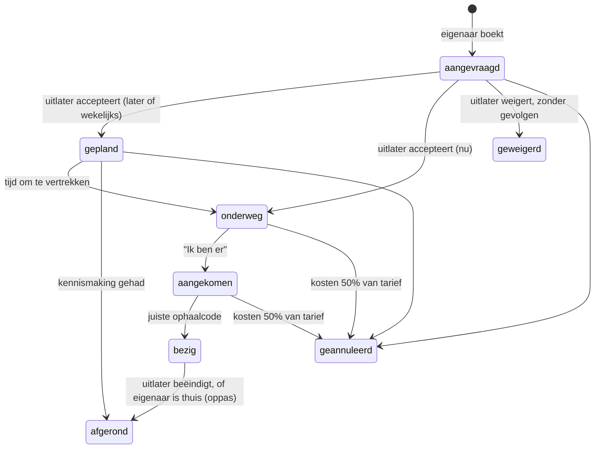

# Woober: plan voor het eerste concept

Oktober 2026 · versie 0.1 · hoort bij de klikbare demo in deze repository

## In het kort

Woober is het zusje van Woofer. Woofer brengt fokkers bij elkaar; Woober brengt hondeneigenaren en hondenmensen uit de buurt bij elkaar, op de manier waarop Uber en Lyft een rit regelen: je opent de app, ziet wie er in de buurt is, boekt, volgt het live en betaalt en beoordeelt in de app.

Woober heeft twee diensten, zoals Uber verschillende ritsoorten heeft. Zelfde app, zelfde systeem, andere selectie:

- **Uitlaten**: een wandeling van 30, 45 of 60 minuten, met live route.
- **Oppas aan huis**: iemand komt bij je thuis op je hond passen, 2 tot 5 uur, te verlengen. Spontaan een avondje weg? Eén tik en de oppas is onderweg.

Zelfde huisstijl als Woofer (kleuren, verloop, knoppen, lettertype, toon), maar een eigen merk, een eigen repository en straks een eigen database.

**De belangrijkste ontwerpkeuze**: het voelt als Uber, maar onder de motorkap is het een marktplaats. De uitlater bepaalt zelf tarief, werkgebied en werktijden en zegt vrij ja of nee; de eigenaar kiest zelf de uitlater. Woober wijst niets toe, stelt geen prijzen vast en straft niemand voor weigeren. Dat is nodig vanwege de Wet platformwerk (zie [Juridische keuzes in de code](#juridische-keuzes-in-de-code)). Het Uber-gevoel komt uit de vormgeving en de snelheid, niet uit de sturing.

## Hoe Uber-elementen in Woober terugkomen

| Uber of Lyft | Woober | Waarom zo |
| --- | --- | --- |
| Kaart met auto's in de buurt | Kaart met uitlaters die online zijn, met reistijd | Direct zien dat er iemand beschikbaar is |
| Rit, Eten, Pakketje bovenin | **Uitlaten** of **Oppas** bovenin het startscherm | Eén app, de selectie past zich aan |
| "Waar wil je heen?" | "Wie laat Luna uit?" of "Wie past op Luna?" met snelkeuzes (nu, vanavond, elke week) | Boeken in twee tikken |
| Kies UberX, Comfort, XL | Kies een uitlater of oppas uit een lijst, met eigen prijs, beoordeling en reistijd | Eigenaar kiest; geen automatische toewijzing |
| Rit verlengen of tussenstop | Oppas met een uur verlengen | Later thuis zonder gedoe |
| Prijs vooraf | Prijs vooraf, maar het tarief komt van de uitlater | Platform bepaalt de vergoeding niet |
| Chauffeur is onderweg, live op de kaart | Uitlater is onderweg, met aftellende minuten | Zelfde gevoel van zekerheid |
| Pincode bij instappen | Ophaalcode van 4 cijfers bij de deur | Hond gaat alleen mee met de juiste persoon |
| Live rit volgen | Live wandeling volgen met route, foto's, plas en poep | Kern van het vertrouwen |
| Betalen in de app, fooi, sterren | Idem, fooi gaat volledig naar de uitlater | Geen contant geld, geen gedoe |
| Chauffeursapp: online gaan, verzoek accepteren | Uitlatermodus: online gaan, verzoek accepteren of weigeren | Weigeren heeft geen gevolgen |
| Acceptatiegraad, deactivatie door algoritme | **Bewust niet** | Raakt twee criteria van de Wet platformwerk |
| Service fee en booking fee | Servicekosten en boekingskosten voor de eigenaar, commissie bij de uitlater | Tijdens de lancering alles gratis |
| Surge pricing | Drukte-toeslag, standaard uit; het grootste deel gaat naar de uitlater | Zie [Prijs en verdienmodel](#prijs-en-verdienmodel) |
| Uber One | Woober Plus: vast bedrag per maand, geen servicekosten | Binding van vaste klanten |
| Promo's en uitnodigen | Tegoed, actiecodes en een uitnodigingscode | Woober betaalt, de uitlater krijgt het volle bedrag |

## Positionering

De markt is niet leeg: Pawshake doet dit landelijk en er zijn veel lokale uitlaatservices. Woober onderscheidt zich op drie punten:

1. **Nu uitlaten**: binnen een kwartier iemand aan de deur, zoals een taxi. Pawshake werkt met aanvragen vooraf.
2. **Live meekijken**: route, foto's en een wandelrapport na afloop, standaard bij elke wandeling.
3. **Vaste wekelijkse wandeling**: één keer instellen, daarna loopt het vanzelf, met dezelfde uitlater.
4. **Oppas op afroep**: geen pension of logeeradres, maar iemand bij jou thuis, binnen een kwartier, met foto's en een plasrondje dat je live ziet. Ook vast in te plannen, bijvoorbeeld elke vrijdagavond.

Start in één stad (voorstel: Nijmegen, gelijk aan de Woofer-pilot). Eerst uitlaters werven, dan eigenaren.

## Rollen en kernflows

Eén account kan beide rollen hebben, zoals iemand die zelf een hond heeft en ook bijverdient. Wisselen gaat via Account.

### Eigenaar

1. Aanmelden: voornaam, e-mail, ophaaladres, 18 jaar of ouder, akkoord met voorwaarden.
2. Hondenprofiel: naam, ras of kruising, geboortedatum, grootte, energie, aanlijnen, omgang met andere honden, karakter, bijzonderheden, dierenarts. Meer honden mogelijk.
3. Startscherm: kaart met uitlaters in de buurt en de vraag "Wie laat je hond uit?".
4. Uitlater kiezen: welke honden, wanneer (nu, later, elke week), hoe lang (30, 45 of 60 minuten), sorteren op afstand, beoordeling of prijs.
5. Nieuwe uitlater? Eerst een gratis kennismaking van een kwartier. Bekende uitlater? Direct boeken.
6. Bevestigen: sleutelafspraak, bericht, betaalmethode (iDEAL | Wero, Apple Pay, kaart), prijsopbouw, annuleringsregels.
7. Live: aanvraag verstuurd, uitlater onderweg met aftellende minuten, ophaalcode, wandeling live met route en foto's, noodknop.
8. Wandelrapport: route, duur, afstand, plas en poep, foto's, notitie van de uitlater, betaling, fooi en beoordeling. Daarna opnieuw boeken of er een vaste wandeling van maken.

### Eigenaar die een oppas boekt

Zelfde stappen als uitlaten, met deze verschillen:

1. Op het startscherm tik je **Oppas**. Kaart, lijst en snelkeuzes laten dan alleen mensen zien die oppas aanbieden ("Nu, 3 uur", "Vanavond", "Elke vrijdag").
2. Je kiest 2, 3, 4 of 5 uur; de app toont tot hoe laat dat is. Standaard gaan al je honden mee.
3. De prijs is het uurtarief van de oppas maal het aantal uren, plus toeslag per extra hond en, afhankelijk van de fase, servicekosten.
4. Bij bevestigen meld je of er camera's in huis hangen, en schrijf je instructies (eten, plasrondje, bench).
5. Bij de deur noem je de code; daarna zie je live: foto's, eten, spelen, slapen, en het plasrondje om het blok op de kaart.
6. Later thuis? **Verlengen** met een uur. Eerder thuis? **Ik ben thuis** rondt af; de geboekte tijd wordt betaald.
7. Oppasrapport met notitie, betaling, fooi en beoordeling.

### Uitlater of oppas

1. Aanmelden en profiel invullen: welke diensten (uitlaten, oppas of allebei), over jou, ervaring, particulier of bedrijf met KvK, vervoer, **eigen tarief** per wandelduur en **eigen uurtarief** voor oppas, toeslag extra hond, maximaal aantal honden (nooit meer dan 8), werkgebied en weekrooster.
2. Verificatie: identiteit, aansprakelijkheidsverzekering en uitbetaalrekening verplicht; VOG optioneel. Pas daarna online.
3. Online gaan met de grote knop op de kaart. Verzoeken uit de buurt verschijnen als kaart onderin, met hond, afstand, moment, duur en wat je ontvangt.
4. Accepteren of weigeren. Weigeren heeft geen gevolgen en wordt niet geteld.
5. Onderweg naar de eigenaar, "Ik ben er", ophaalcode invullen, wandeling starten.
6. Tijdens de wandeling: foto, plas, poep, water en notitie met één tik; noodknop; beëindigen. Tijdens oppas: foto, eten, plas, slapen en notitie; afronden met "Eigenaar is thuis".
7. Afronden: verdiensten zien en de eigenaar beoordelen. Overzicht per week onder Verdiensten.

### Status van een boeking

## Wat de demo laat zien

De demo draait als iOS-app, Android-app en web app. Alle gegevens zijn nepdata in het geheugen; de andere kant (uitlater of eigenaar) wordt nagespeeld en de tijd loopt 30 keer sneller. Starten: zie [README.md](README.md).

| Onderdeel | Bestand |
| --- | --- |
| Welkom met snelle demo als eigenaar of uitlater | `src/app/welkom.tsx` |
| Aanmelden met rolkeuze | `src/app/aanmelden.tsx` |
| Hondenprofiel | `src/components/HondFormulier.tsx`, `src/app/hond-aanmaken.tsx`, `src/app/hond/[id].tsx` |
| Startscherm eigenaar met kaart en keuze Uitlaten of Oppas | `src/app/(tabs)/index.tsx` |
| Uitlater of oppas kiezen (de "Kies je rit"-stap) | `src/app/boeken.tsx`, `src/lib/zoeken.ts` |
| Profiel van een uitlater | `src/app/uitlater/[id].tsx` |
| Kennismaking aanvragen | `src/app/kennismaking.tsx` |
| Bevestigen en betalen | `src/app/bevestigen.tsx` |
| Live volgen, ophaalcode, noodknop; bij oppas ook verlengen en "Ik ben thuis" | `src/app/wandeling/[id].tsx`, `src/components/IncidentBlad.tsx` |
| Wandel- of oppasrapport, fooi, beoordeling | `src/app/rapport/[id].tsx` |
| Activiteit en vaste wandelingen | `src/app/(tabs)/activiteit.tsx` |
| Chat met signalering van betalen buiten de app | `src/app/chat/[id].tsx` |
| Melden en blokkeren | `src/components/MeldenBlad.tsx` |
| Uitlater: online gaan en verzoeken | `src/app/werk/index.tsx` |
| Uitlater: opdracht uitvoeren | `src/app/opdracht/[id].tsx` |
| Uitlater: verdiensten (onder Account), opdrachten, profiel, verificatie | `src/app/werk/*`, `src/app/verdiensten.tsx`, `src/components/UitlaterFormulier.tsx`, `src/app/verificatie.tsx` |
| Woober Fit voor uitlaters (tab Fit): stappen per dag, week en maand, met honden gewandeld, koppelingen met fitness-apps op slot | `src/app/werk/fit.tsx`, `src/components/Stappenteller.tsx`, `src/lib/fit.ts`, `src/lib/stappen.ts` |
| Veiligheid en hulp | `src/app/veiligheid.tsx` |
| Plekken: kaart met losloopgebieden, hondvriendelijke stranden, horeca en andere plekken, met reviews; gebruikers voegen zelf plekken toe | `src/app/(tabs)/plekken.tsx`, `src/app/plek/[id].tsx`, `src/app/plek-toevoegen.tsx`, `src/data/plekken.ts`, `src/lib/plekken.ts` |
| Kaart van de demowijk met routes | `src/components/Kaart.tsx`, `src/data/stad.ts`, `src/lib/route.ts` |
| Prijzen, servicekosten, commissie, annuleren | `src/lib/prijs.ts`, `src/components/PrijsRegels.tsx` |
| Verdienmodel: fases, drukte, Woober Plus, tegoed | `src/lib/verdienmodel.ts`, doorrekenen in `src/app/verdienmodel.tsx` en inplannen in `src/app/beheer.tsx` (Account, Beheer, alleen voor beheerders) |
| Simulatie van de andere kant | `src/lib/simulatie.ts`, `src/state/AppContext.tsx` |
| Databaseschema met RLS (concept) | `supabase/migrations/`, test: `npm run test:db` |

## Prijs en verdienmodel

We beginnen zonder winst om gebruikers binnen te halen. Het Uber-achtige verdienmodel staat al volledig klaar, in de app en in de database, en gaat aan door een ander model in te plannen. Er hoeft dan niets meer gebouwd te worden.

### Wat altijd geldt

- De uitlater kiest een tarief per 30, 45 en 60 minuten en een toeslag per extra hond. Voor oppas kiest de oppas een **uurtarief**; de prijs is uurtarief maal aantal uren. Verlengen gaat per uur; eerder klaar betekent de geboekte tijd betalen.
- De eigenaar ziet vóór het boeken de volledige prijs, met alle kosten.
- Fooi gaat volledig naar de uitlater.
- Annuleren is gratis tot 2 uur van tevoren, of zolang de uitlater nog niet onderweg is. Daarna krijgt de uitlater 50% van het tarief. Gebruikt tegoed komt altijd terug.
- Elke boeking bewaart het model en de volledige prijsopbouw. Een nieuw model werkt nooit terug; verlengen rekent met de opbouw van de boeking. Een vaste wandeling krijgt elke keer de prijs van het moment waarop die keer wordt ingepland.

### De knoppen en drie fases

Alle knoppen staan op één plek: `src/lib/verdienmodel.ts` in de app, de tabel `verdienmodellen` in de database. Beheerders plannen een model in en rekenen de fases door onder Account, Beheer; gewone gebruikers en de demo zien dit niet.

| Knop | Bij Uber | Lancering | Groei | Uber-model |
| --- | --- | --- | --- | --- |
| Servicekosten eigenaar, als deel van tarief en drukte | Service fee | Geen | 5%, min. €0,49 | 10%, min. €0,99, max. €5 |
| Boekingskosten per boeking | Booking fee | Geen | Geen | €0,49 |
| Commissie op de uitbetaling | Service fee chauffeur | Geen | 10% | 20% |
| Drukte-toeslag | Surge | Uit | Uit | Tot 1,5x, 75% naar de uitlater |
| Woober Plus, geen servicekosten | Uber One | Uit | €4,99 per maand | €4,99 per maand |
| Welkomsttegoed | Korting eerste rit | Geen | €5 | Geen |
| Uitnodigingstegoed, voor allebei | Referral | Geen | €5 | €5 |
| Actiecodes | Promo codes | Kan altijd | Kan altijd | Kan altijd |

Voorbeelden met Sanne (€12 voor 30 minuten, €11 per uur oppas), één hond. Per fase: wat de eigenaar betaalt, wat Sanne ontvangt en wat Woober houdt vóór de kosten van de betaalprovider.

| | Lancering | Groei | Uber-model | Uber-model bij drukte 1,5x |
| --- | --- | --- | --- | --- |
| 30 minuten uitlaten | €12,00 / €12,00 / €0 | €12,60 / €10,80 / €1,80 | €13,69 / €9,60 / €4,09 | €20,29 / €13,20 / €7,09 |
| 3 uur oppas | €33,00 / €33,00 / €0 | €34,65 / €29,70 / €4,95 | €36,79 / €26,40 / €10,39 | €54,94 / €36,30 / €18,64 |

Met Woober Plus betaalt de eigenaar in het Uber-model €12,49 voor dezelfde wandeling; Plus loont dan vanaf 5 wandelingen per maand. Tijdens de lancering betaalt Woober de transactiekosten zelf en elk tegoed: dat is de prijs van gratis, en staat zichtbaar in het grootboek.

### Zo staat het klaar in de database

Migratie `supabase/migrations/20261022010000_verdienmodel.sql`:

- `verdienmodellen` en `verdienmodel_planning`: wisselen van fase is een regel inplannen met `geldig_vanaf`. Nooit met terugwerkende kracht; een ingepland model ligt vast. Een hogere commissie kan pas 15 dagen na aankondiging ingaan (zie hieronder); de database dwingt dat af. Gunstiger voor uitlaters kan direct.
- `bereken_prijs()`: de enige plek waar de database een prijs uitrekent, met dezelfde regels en afronding als `berekenPrijs()` in de app. De test vergelijkt 900 prijzen tussen app en database.
- Bij elke boeking: model, drukte-factor, drukte, deel voor de uitlater, servicekosten, Plus, boekingskosten, tegoed en commissie; `totaal` en `uitbetaling` rekent de database zelf uit.
- `druktefactoren`: per gebied (postcode van 4 cijfers), dienst en tijdvak. Een serverproces zet ze uit openstaande aanvragen en het aantal uitlaters dat online is met een werkgebied daar; nooit uit hun posities.
- `abonnementen` (Woober Plus, opzeggen loopt tot het einde van de maand), `tegoed_mutaties` (saldo is de som), `promocodes` (niet op te vragen, alleen te verzilveren) en `uitnodigingen` (beloning na de eerste afgeronde wandeling van de nieuwe gebruiker).
- `grootboek`: elke afgeronde boeking, annulering met kosten en fooi als regels voor eigenaar, uitlater en Woober (servicekosten, boekingskosten, commissie, drukte, tegoed) die samen op nul uitkomen. Alleen voor Woober; blijft bewaard als een account wordt verwijderd, zonder persoon.

### Betalen met Stripe Connect

- De eigenaar betaalt het totaal aan Woober; na afronden gaat `uitbetaling` naar het Connect-account van de uitlater. Gebruik losse betalingen en overboekingen (separate charges and transfers), geen destination charges: bij tegoed legt Woober bij, en dan is de platformvergoeding negatief.
- **Saldo (wallet) in plaats van automatisch uitbetalen** (besloten 30 oktober 2026): het Connect-account van de uitlater krijgt een handmatig uitbetalingsschema. Wat hij verdient, blijft op zijn Stripe-saldo staan tot hij in de app op Uitbetalen tikt (vanaf 10 euro, of alles); dan maakt Woober via de Payouts API een uitbetaling. Zo zijn er geen kleine overboekingen per wandeling, en bewaart Woober zelf geen geld van gebruikers: het staat bij Stripe, dat daar een vergunning voor heeft. Eigen saldo houden zou Woober een betaalinstelling of elektronischgeldinstelling maken (vergunning van DNB). Stripe houdt geld bij handmatige uitbetalingen hooguit 90 dagen vast; een serverproces betaalt wat langer staat automatisch uit.
- **Met saldo betalen als eigenaar**: een uitlater die zelf boekt, betaalt (een deel) met zijn saldo. Bij Stripe gaat dat met een afschrijving van het Connect-account naar Woober (account debits, binnen de SEPA-landen); daarvoor is vooraf toestemming van de uitlater nodig, dus die staat in de voorwaarden. De andere uitlater krijgt evenveel als bij een gewone betaling. Saldo is eigen geld en geen tegoed: tegoed betaalt Woober.
- Database: `met_saldo` op `boekingen`, tabel `uitbetalingen`, functies `mijn_saldo()`, `vraag_uitbetaling_aan()` en `betaal_met_saldo()` in `20261030000000_saldo.sql`; het saldo volgt uit de rekening uitlater in het grootboek. Account verwijderen kan pas als het saldo is uitbetaald.
- Kaart en Apple Pay kunnen een bedrag reserveren en pas na de wandeling afschrijven. iDEAL kan dat niet; daar betaalt de eigenaar bij het boeken en volgt bij tijdig annuleren een terugbetaling. De demo laat dat verschil al zien.
- Woober Plus via Stripe Billing; de webhook maakt de regel in `abonnementen`.
- Het grootboek is de basis voor de afstemming met Stripe en voor de boekhouding.

### Mollie Connect als alternatief (onderzocht 30 oktober 2026)

Kan, maar nog niet beslissen voordat Mollie de open vragen in ACTIES.md (stap 3) heeft beantwoord.

- **iDEAL | Wero kan bij allebei.** iDEAL heet sinds 29 januari 2026 iDEAL | Wero (logo en naam verplicht sinds 31 maart 2026); vanaf eind 2026 lopen betalingen geleidelijk via Wero, afronding eind 2027. Stripe en Mollie bieden het allebei aan. Voor deze eis is wisselen dus niet nodig. Mollie is wel Principal Member van EPI, het bedrijf achter Wero, en een Nederlandse betaalinstelling onder toezicht van DNB.
- **Grootste risico: uitlaters zonder KvK.** Elke uitlater wordt een verbonden account bij Mollie, en Mollie controleert die als bedrijf (KYB) met bedrijfsgegevens. Een particulier zonder KvK-inschrijving lijkt daar niet in te passen; Stripe Connect Express kan wel particulieren aansluiten. Dit beslist de open vraag in Open vragen (alleen particulieren of ook KvK) mee.
- **Saldo met Mollie, voorstel: vertraagde routing.** Eigenaren betalen aan het marktplaatsaccount van Woober; Mollie houdt het geld vast (niet Woober) tot Woober routes maakt. Het saldo van een uitlater is wat nog niet naar hem is gerouteerd. Tikt hij op Uitbetalen, dan routeert Woober dat bedrag naar zijn Mollie-account en betaalt Mollie het volgens zijn uitbetaalschema uit. Routes moeten binnen 90 dagen na de betaling bestaan, net als de 90 dagen bij Stripe, dus het automatisch uitbetalen na 90 dagen blijft. Vertraagde routing moet Mollie aanzetten en werkt met bruto-afrekening: de kosten van Mollie komen als maandfactuur.
- **Betalen met saldo bij Mollie:** het nog niet gerouteerde geld van de uitlater direct naar de andere uitlater routeren. Anders via Balance Transfers, maar daar geldt standaard een maximum van 1.000 euro per maand per verbonden account en de uitlater moet toestemming geven.
- **Wat in Woober gelijk blijft:** het saldo, de regels in `src/lib/saldo.ts`, het grootboek en `20261030000000_saldo.sql` zijn niet aan Stripe gebonden. Bij een wissel worden alleen de kolommen `stripe_payment_intent` en `stripe_payout_id` algemeen (bijvoorbeeld `betaling_ref`, `uitbetaling_ref`), komt er een serverkoppeling voor Mollie in plaats van Stripe, en gaat "Stripe" uit de teksten (saldo, voorwaarden). De controle van identiteit en rekening van uitlaters doet Mollie bij het aansluiten; Stripe Identity (stap 5 in ACTIES.md) is dan niet nodig, de verzekering blijft handwerk.

### Eisen voor betalen en de wallet (Kjell, 30 oktober 2026)

1. Uitlaters zonder KvK moeten mee kunnen doen. Dat moet de betaalpartner dus ondersteunen; bij Stripe kan het, bij Mollie is het nog niet bevestigd.
2. Een Woober Wallet waarop je geld stort en waarmee je betaalt, eventueel als credits zoals bij italki (1 euro wordt 1 credit, 1:1 terug te krijgen).
3. De uitlater bepaalt wanneer er wordt uitbetaald.
4. Betalen en uitbetalen kosten de gebruiker niets (Woober draagt de kosten van de betaalpartner), zonder maximum tenzij de wet er een vraagt.
5. Betalen met iDEAL | Wero kan altijd.

1, 3, 4 en 5 passen in wat er staat: het saldo van uitlaters bij de betaalpartner, uitbetalen op verzoek, en iDEAL | Wero bij elke boeking. De drempel van 10 euro voor een uitbetaling is een minimum, geen maximum.

**Storten door eigenaren (eis 2) is juridisch de lastige.** Geld dat iemand vooraf stort, waarmee hij bij anderen (de uitlaters) betaalt en dat hij 1:1 terug kan krijgen, is elektronisch geld. Of het euro's of credits heet maakt niet uit: credits zoals bij italki zijn dat net zo goed. Wie dat uitgeeft, heeft in principe een vergunning van DNB als elektronischgeldinstelling nodig. Mogelijke wegen, van eenvoudig naar zwaar:

- **A. Niet storten, per boeking betalen** (zoals nu): iDEAL | Wero, Apple Pay of kaart bij elke boeking; alleen uitlaters hebben een saldo, en dat staat bij de betaalpartner. Geen vergunning nodig. Advies voor de lancering.
- **B. Storten bij de betaalpartner**: de storting is een betaling aan het marktplaatsaccount die de betaalpartner vasthoudt tot een boeking; wat binnen 90 dagen niet is gebruikt, gaat automatisch terug. Alleen als de betaalpartner dit zo wil uitvoeren en een jurist bevestigt dat Woober dan zelf geen elektronisch geld uitgeeft.
- **C. Woober geeft zelf tegoed of credits uit** (italki): kan zonder vergunning alleen met een uitzondering, bijvoorbeeld voor een beperkt netwerk (alleen te gebruiken bij uitlaters die een overeenkomst met Woober hebben; melden bij DNB boven 1 miljoen euro per jaar) of voor kleine instellingen (vroeger maximaal 150 euro per gebruiker; de huidige regels nakijken). Terugbetalen dan alleen naar de rekening waarvan het geld kwam, vanwege witwasregels.

### Een fase wisselen

1. Kies een bestaand model of maak een nieuw model aan in `verdienmodellen`.
2. Kondig het aan bij uitlaters (in de app en per e-mail) en plan het in, bij een hogere commissie minstens 15 dagen vooruit.
3. Eigenaren zien de nieuwe prijs gewoon vooraf bij het boeken; wie een vaste wandeling heeft, krijgt vooraf een bericht.
4. Bestaande boekingen houden hun prijs.

## Juridische keuzes in de code

De Wet platformwerk (implementatie van Richtlijn (EU) 2024/2831, beoogd per 1 januari 2027) gaat uit van een arbeidsovereenkomst als twee van vijf criteria gelden. Zo houdt de demo daar rekening mee:

| Criterium | Hoe Woober het vermijdt | Waar in de code |
| --- | --- | --- |
| Platform bepaalt de vergoeding | Uitlater kiest het tarief; Woober rekent alleen servicekosten en commissie (tijdens de lancering niets) | `UitlaterFormulier.tsx`, `prijs.ts`, `bereken_prijs()` |
| Platform wijst werk toe | Eigenaar kiest de uitlater; sorteren alleen op de keuze van de eigenaar | `boeken.tsx`, `zoeken.ts` |
| Toezicht op het werk | Route alleen zichtbaar voor de eigenaar tijdens de wandeling; niet gebruikt voor beoordeling | `kaartLagen.ts`, `veiligheid.tsx` |
| Beperken van weigeren, ook via sancties | Weigeren en afzeggen zonder gevolgen; er wordt geen acceptatiegraad bijgehouden | `weiger()` in `AppContext.tsx`, `wijzig_status()` |
| Richtlijnen opleggen | Alleen veiligheid en wettelijke regels (ophaalcode, aanlijnen, opruimplicht, maximum aantal honden) | `veiligheid.tsx` |

Bij het verdienmodel:

- **Drukte-toeslag**: Woober bepaalt de hoogte van die toeslag, terwijl het tarief van de uitlater de basis blijft. Daarom staat drukte alleen aan in het Uber-model, gaat het grootste deel naar de uitlater en is het per model uit te zetten. Laat dit toetsen voordat het aangaat.
- **P2B-verordening (EU) 2019/1150**: uitlaters zijn zakelijke gebruikers. Een wijziging in de voorwaarden, zoals een hogere commissie, minstens 15 dagen vooraf aankondigen. Ook duidelijk maken waarop de lijst is gesorteerd (alleen op de keuze van de eigenaar) en wat Woober inhoudt (`verdiensten.tsx`).
- **Consumentenrecht**: de eigenaar ziet de totaalprijs met alle kosten vóór het boeken, inclusief drukte en boekingskosten (`PrijsRegels.tsx`).

Verder: meldingen en schorsingen beoordeelt altijd een mens, met uitleg en de mogelijkheid om te reageren. Reviews alleen na een betaalde wandeling. Adres pas zichtbaar na accepteren. Locatie alleen tijdens de wandeling, na 30 dagen weg.

Twee punten blijven voor een arbeidsrechtspecialist: of de "Nu"-knop met snelle reactie als sturing kan worden gezien, en of oppas aan huis (en mogelijk uitlaten) onder de Regeling dienstverlening aan huis valt, waarbij de eigenaar als particuliere opdrachtgever lichtere werkgeversplichten heeft.

### Extra bij oppas aan huis

- **Iemand in je huis**: daarom altijd eerst een kennismaking, de code bij de deur, en huisregels in het bericht.
- **Camera's**: de eigenaar meldt vooraf of er camera's hangen. Iemand filmen zonder dat die het weet mag niet; de oppas ziet het vóór de afspraak.
- **Verzekering**: de aansprakelijkheidsverzekering van de oppas moet ook schade in het huis dekken, niet alleen schade door de hond. Navragen bij verzekeraars; mogelijk een collectieve polis via Woober.
- **Locatie**: alleen tijdens het plasrondje om het blok; binnen is de positie gewoon het adres.

## Van demo naar MVP

De demo is zo opgezet dat elk nagespeeld onderdeel één plek heeft die later wordt vervangen.

| Nu in de demo | Straks in de MVP |
| --- | --- |
| Staat in het geheugen (`AppContext.tsx`) | Supabase in eu-central-1 met het schema in `supabase/migrations/`; Auth met e-mail, Apple en Google. **Klaar voor account, adres, honden en uitlaatprofiel** (`src/lib/account.ts`) |
| Andere kant nagespeeld (`simulatie.ts`) | Echte gebruikers; statuswijzigingen via de databasefuncties (`wijzig_status`, `start_wandeling`) |
| Eigen SVG-kaart (`Kaart.tsx`) | **Klaar voor plekken**: Leaflet met de kaart van PDOK (`EchteKaart.tsx`, `src/lib/kaart.ts`). Voor boekingen komen routes en de uitlater erbij |
| Positie berekend uit de tijd | `expo-location` met achtergrondtaak, alleen tijdens `bezig`; posities via Supabase Realtime naar de eigenaar |
| Betaling getoond | Stripe Connect: account per uitlater, losse betalingen en overboekingen, webhooks via een Supabase Edge Function (zie [Betalen met Stripe Connect](#betalen-met-stripe-connect)) |
| Verdienmodel in het geheugen, te wisselen in de demo | Tabel `verdienmodellen` met planning; alleen het team plant een fase in |
| Drukte nagebootst in `verdienmodel.ts` | Serverproces (Edge Function of `pg_cron`) vult `druktefactoren` |
| Verificatie afvinken | **Nu**: een medewerker controleert de stukken per e-mail en zet de stappen aan in Beheer. Later Stripe Identity voor ID en de polis uploaden naar een privé-bucket |
| Meldingen bovenin (`merk.tsx`) | Pushmeldingen via `expo-notifications`, aangestuurd door wijzigingen in de database |
| Verlengen gaat direct (`verleng_oppas()`) | De oppas bevestigt eerst in de app; bij kaart en Apple Pay wordt de reservering opgehoogd, bij iDEAL volgt een tweede betaling |
| Foto's als kleurvlakken | Foto's uploaden naar Supabase Storage, alleen zichtbaar voor de deelnemers |
| Plekken als nepdata (`src/data/plekken.ts`) | **Klaar**: tabel `plekken` met reviews, gevuld door het team (17 onderzochte plekken in Nijmegen, `supabase/plekken/nijmegen.json`) en door gebruikers; een medewerker controleert in Beheer. De demo houdt de nepdata |
| Melden en blokkeren lokaal | **Klaar voor plekken en reviews**: meldingen komen in Beheer, een medewerker beslist met een besluit. Melden van personen volgt met de echte boekingen |

Het schema in `supabase/migrations/` is getest in een lokale Postgres (`npm run test:db`, 115 controles). Belangrijkste regels:

- Prijzen berekent de database uit het tarief van de uitlater (`tarief_voor()`) en het verdienmodel dat geldt (`bereken_prijs()`); de app stuurt nooit een bedrag mee. App en database rekenen tot op de cent hetzelfde.
- Een hogere commissie gaat pas 15 dagen na aankondiging in; een ingepland model ligt vast.
- Tegoed, actiecodes, Plus en grootboek veranderen alleen via databasefuncties of door Woober; het grootboek komt per boeking op nul uit.
- Een dienst boeken kan alleen bij iemand die die dienst aanbiedt; oppas alleen in hele uren.
- Verlengen kan alleen de eigenaar, en alleen bij oppas.
- Adres, ophaalcode en Stripe-gegevens staan in aparte tabellen, omdat RLS rijen afschermt en geen kolommen.
- Verificatievelden kan alleen Woober zetten (kolomrechten).
- Een eerste wandeling kan pas na een afgeronde kennismaking; boeken bij een geblokkeerde gebruiker kan niet.
- Gebruikers voegen zelf plekken toe, hooguit vijf per dag. Zo'n plek is meteen zichtbaar met de status `nieuw`; alleen een medewerker zet hem op `gecontroleerd` of `verborgen`. De toevoeger kan een nieuwe plek nog verwijderen, niet aanpassen. Iedere gebruiker schrijft één review per plek, past alleen de eigen review aan en ziet geen reviews van gebruikers die geblokkeerd zijn; een gemelde review beoordeelt een medewerker.
- Locatie toevoegen kan alleen tijdens een lopende wandeling, door de uitlater van die wandeling.

### Volgorde van bouwen

1. ✅ Supabase-project aanmaken (los van Woofer), migratie draaien, Auth instellen. Inloggen met e-mail, Apple en Google zit in de app (`src/lib/account.ts`); de sleutels van Apple en Google moeten nog in Supabase (zie [README.md](README.md#inloggen-met-apple-en-google-instellen)).
2. ✅ Accounts, honden en uitlaatprofielen echt opslaan, account verwijderen in de app; demo-modus behouden voor presentaties. Tot stap 3 klaar is, kan een echt account niet boeken: het startscherm toont de kaart met plekken en de wachtlijst.
   ✅ Daarbij, om eerst waarde te bieden zonder uitlaters: plekken echt (kaart, reviews, toevoegen, melden), Beheer voor moderatie, verificatie, wachtlijst, teksten en verdienmodel, en gebruiksvoorwaarden. Wat er nog openstaat: [ACTIES.md](ACTIES.md).
3. Boeken en statusovergangen via de databasefuncties, met Realtime.
4. Locatie tijdens de wandeling (development build nodig, Expo Go volstaat dan niet meer). De echte kaart is er al (`src/components/EchteKaart.tsx`); routes en de positie van de uitlater komen erbij.
5. Stripe Connect en iDEAL; eerst in testmodus. Het grootboek afstemmen met de Stripe-uitbetalingen. Fase lancering actief.
6. Pushmeldingen.
7. Foto's, moderatie, account verwijderen inclusief foto's in Storage.
8. Besloten test met een handvol uitlaters en eigenaren in de pilotstad.

## Bewust nog niet in de demo

- Groepswandelingen met honden van verschillende eigenaren
- Logeeropvang bij de oppas thuis en overnachten (oppas tot in de nacht kan wel, tot 5 uur, te verlengen)
- Direct boeken zonder acceptatie
- Abonnement voor uitlaters
- Het serverproces dat drukte berekent (tabel en regels staan klaar)
- Koppeling met Woofer, zoals hetzelfde hondenprofiel
- Echte foto's, echte locatie, echte betalingen en pushmeldingen
- Koppelingen van Woober Fit met Apple Gezondheid, Health Connect, Strava en Garmin (wat ervoor nodig is: [ACTIES.md](ACTIES.md))

## Genomen beslissingen

- **Tabs voor eigenaren (oktober 2026)**: de eerste tab heet Zoeken; Uitlaten of Oppas kies je bovenin het startscherm. Een eigen tab voor Oppas is afgewezen: zes tabs passen niet goed op een telefoon, het startscherm zou dubbel bestaan en de uitlater-kant is ook niet gesplitst. Overwogen is Activiteit naar Account te verplaatsen en de vrije tab te gebruiken voor Honden (profiel, eerdere wandelingen en rapporten per hond). Voorlopig blijft Activiteit een eigen tab, omdat geplande boekingen en de teller dan direct zichtbaar zijn, zoals bij Uber. Gaat Activiteit later toch naar Account, laat dan de eerstvolgende geplande boeking ook op Zoeken zien.
- **Wisselen van rol en bewerken in de app (oktober 2026)**: bovenaan Account staat bij beide rollen een keuze Eigenaar of Uitlater, naar het voorbeeld van italki; de losse menuregels om te wisselen zijn weg. Beheerders passen teksten aan in een bewerkmodus met een hamertje bij elke aanpasbare tekst, in plaats van alleen in een lange lijst.
- **Woober Fit voor uitlaters (oktober 2026)**: mensen letten steeds meer op hun gezondheid, en daar sluit Woober op aan met het idee "ga wandelen en neem een hond mee". Woober Fit is voor uitlaters, die het meest lopen: een eigen tab Fit met stappen per dag, week en maand, hoeveel je deze week met honden wandelde, en koppelingen met Apple Fitness, Google Fit, Strava en Garmin (eerst op slot). Verdiensten ging daarvoor van een eigen tab naar Account, zoals een portemonnee in het accountmenu. Eerst stond Woober Fit kort in de tab Activiteit van eigenaren; dat is teruggedraaid, Activiteit blijft het boekingsoverzicht. Stappen blijven op de telefoon en worden nooit gebruikt om uitlaters te beoordelen.

## Open vragen

- [ ] Wanneer van Lancering naar Groei en naar het Uber-model? Voorstel: op een aantal wandelingen per week in de pilotstad, niet op een datum.
- [ ] Percentages in Groei en Uber-model: wat accepteren uitlaters en eigenaren? Bij oppas zijn de bedragen hoger; een maximum op de servicekosten staat klaar.
- [ ] Drukte-toeslag aanzetten, en welk deel naar de uitlater?
- [ ] Woober Plus via de eigen betaling (zoals Uber One) of via in-app aankoop van Apple en Google? Plus geeft korting op diensten buiten de app; laten bevestigen bij de review van de stores.
- [ ] Btw over servicekosten, boekingskosten, commissie en Plus, en hoe dat werkt voor uitlaters onder de kleineondernemersregeling.
- [ ] Misbruik van welkomst- en uitnodigingstegoed met meerdere accounts: controleren op betaalmiddel of telefoonnummer?
- [ ] Oppas: minimaal 2 uur? Nachtoppas (blijven slapen) toevoegen, en zo ja met een vast nachttarief?
- [ ] Verlengen: mag de oppas weigeren, en wat als de eigenaar dan niet op tijd thuis is?
- [ ] "Nu"-verzoeken: blijft de eigenaar één uitlater tegelijk kiezen, of mag een verzoek naar de drie dichtstbijzijnde tegelijk (eerste die accepteert)? Laten toetsen.
- [ ] Verzekering per uitlater of collectief via Woober?
- [ ] Alleen particuliere uitlaters, of ook bedrijven met KvK? De demo laat beide zien.
- [ ] Plekken: willen we horeca later laten betalen voor een uitgelichte plek, of blijft de kaart neutraal? En mag de eigenaar van een zaak zijn plek claimen en aanpassen?
- [ ] Mag Woober een VOG vragen? In de demo optioneel.
- [ ] Pilotstad: Nijmegen?
- [ ] **Reviews zoals italki?** Besloten op 30 oktober 2026: wel melden van een no-show of late afzegging bij de boeking, beoordeeld door een medewerker, met geld terug als de eigenaar gelijk krijgt (gebouwd in de demo); geen percentages. De toets door de arbeidsrechtspecialist staat in ACTIES.md. Het idee: per uitlater kenmerken die eigenaren bij een review aantikken (zoals "Geduldig · 2", "Stuurt foto's · 7") en laten zien of iemand vaak niet komt opdagen of last minute afzegt. Advies: de kenmerken zijn een goed idee en passen bij de huidige regels (alleen na een betaalde wandeling). Percentages voor aanwezigheid of reageren niet: dat is een acceptatiegraad die we volgens de afspraak over de Wet platformwerk niet bijhouden, en de EU-richtlijn voor platformwerk (omzetten uiterlijk 2 december 2026) maakt toezicht en sturing op het werk van zelfstandigen extra gevoelig. Wel mogelijk: een eigenaar meldt een no-show of late afzegging, een medewerker beoordeelt dat, de eigenaar krijgt zijn geld terug, en bij herhaling beslist een mens. Laten toetsen bij de arbeidsrechtspecialist voordat er iets zichtbaar wordt.
- [ ] Woober Fit later ook voor eigenaren die zelf met hun hond lopen? En een dagdoel dat je zelf kiest, of uitdagingen met de buurt?
- [ ] **Naam**: Woober lijkt in klank en schrijfwijze op Uber. Laat een merkenonderzoek doen (BOIP en EUIPO) voordat je investeert in het merk; grote merken treden vaak op tegen namen die op hun merk lijken.

Dit plan is geen juridisch advies; laat het juridisch kader toetsen voor de lancering.
